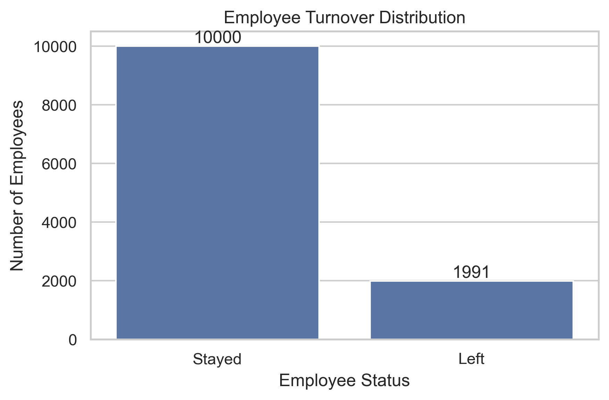
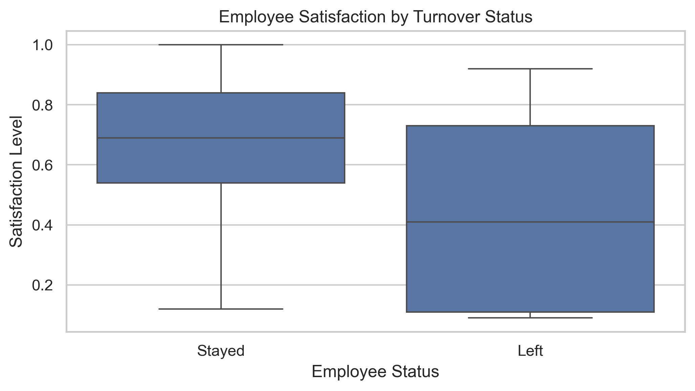
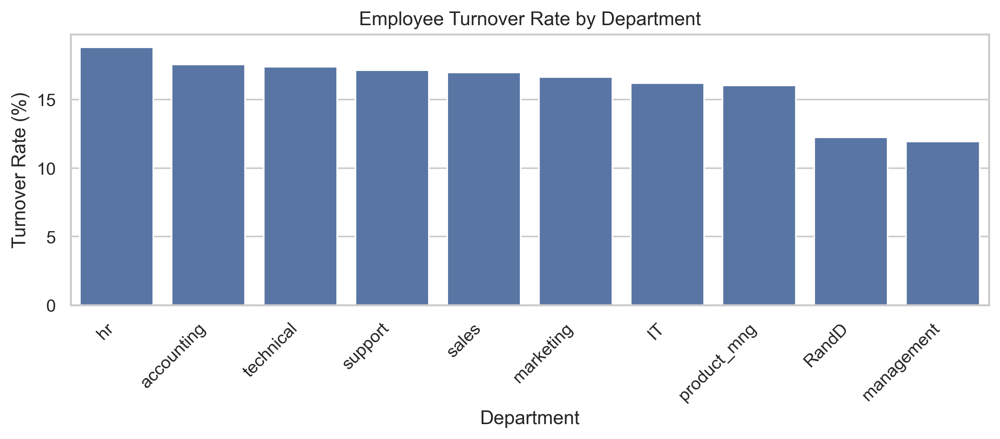
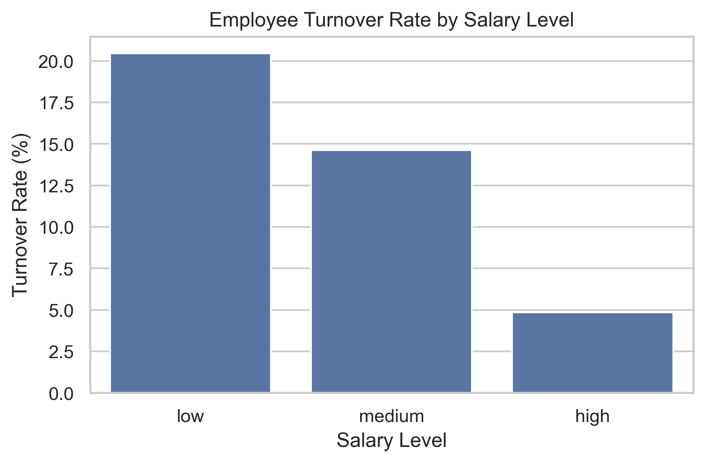
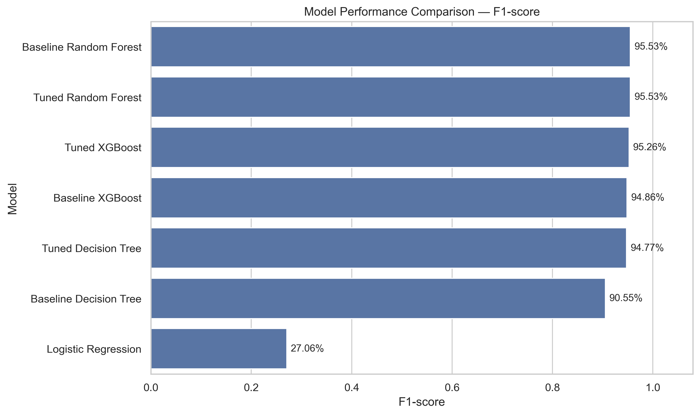
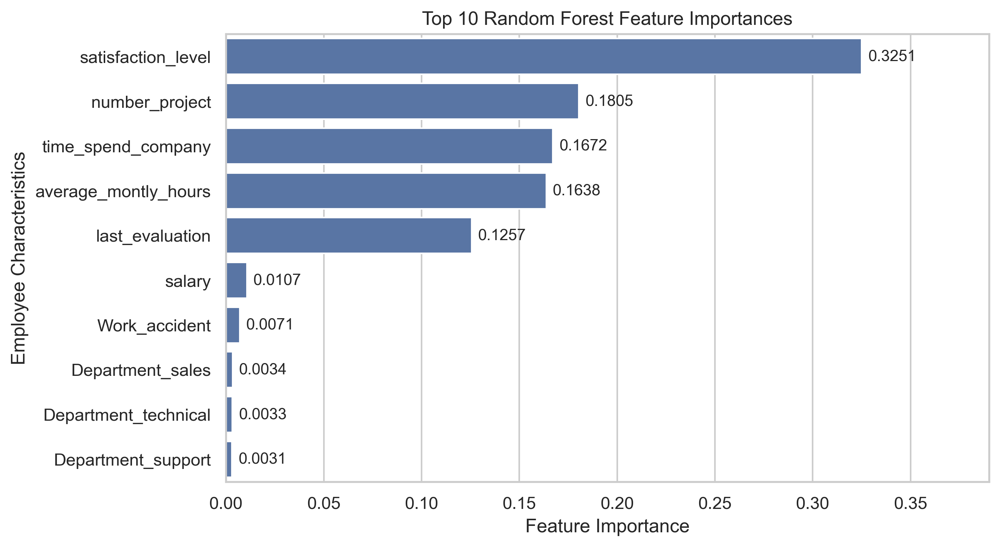

# Employee Turnover Prediction Using Machine Learning

### Google Advanced Data Analytics Capstone Project

**Organisation:** Salifort Motors  
**Project Type:** Machine Learning | Binary Classification | HR Analytics  
**Author:** Reginald Didia

## 1. Project Overview

Employee turnover is a significant challenge for organisations because it can increase recruitment costs, reduce productivity, and lead to the loss of experienced employees.

This project investigates employee turnover at Salifort Motors, a fictional organisation featured in the Google Advanced Data Analytics Capstone Project.

The objective was to identify factors associated with employee departures and develop machine learning models capable of predicting whether an employee would leave the organisation.

The project applies exploratory data analysis (EDA), data preprocessing, classification modelling, hyperparameter tuning, cross-validation, and model evaluation to generate insights that can support employee retention strategies.

## 2. Business Problem and Objectives

**Business Question:**

Can employee characteristics and workplace conditions be used to predict employee turnover and support data-driven employee retention strategies?

### Project Objectives

- Analyse employee turnover patterns and workplace characteristics.
- Identify relationships between employee satisfaction, workload, tenure, salary, and turnover.
- Develop and compare multiple classification algorithms.
- Optimise model performance using GridSearchCV and cross-validation.
- Evaluate models using accuracy, precision, recall, and F1-score.
- Identify influential predictors of employee turnover.
- Provide actionable recommendations for HR stakeholders.

## 3. Dataset Description

The original dataset contained 14,999 employee records and 10 variables.

After removing 3,008 duplicate records, the cleaned dataset contained 11,991 observations with no missing values.

| Dataset Characteristic | Result |
|---|---|
| Original observations | 14,999 |
| Duplicate records removed | 3,008 |
| Final observations | 11,991 |
| Original variables | 10 |
| Employees who stayed | 10,000 (83.40%) |
| Employees who left | 1,991 (16.60%) |
| Missing values | None |

### Target Variable

The target variable is `left`:

- `0`: Employee stayed
- `1`: Employee left

### Predictor Variables

The dataset contains the following employee characteristics:

- `satisfaction_level`
- `last_evaluation`
- `number_project`
- `average_montly_hours`
- `time_spend_company`
- `Work_accident`
- `promotion_last_5years`
- `Department`
- `salary`

**Dataset:** [HR Capstone Dataset](Data/HR_capstone_dataset.csv)

## 4. Exploratory Data Analysis

Exploratory Data Analysis was conducted to investigate employee turnover patterns, understand relationships between variables, and identify potential predictors.

### 4.1 Employee Turnover Distribution



Of the 11,991 employee records, 1,991 (16.60%) indicated that the employee had left the organisation.

The dataset is imbalanced, with substantially more employees staying than leaving. This makes metrics such as precision, recall, and F1-score important when evaluating classification models.

### 4.2 Employee Satisfaction and Turnover



Employees who left generally reported lower satisfaction levels than employees who stayed.

The median satisfaction level was approximately 0.41 among employees who left, compared with 0.70 among those who stayed.

This suggests that employee satisfaction is an important characteristic associated with turnover.

### 4.3 Employee Turnover by Department



Employee turnover rates varied across departments.

The HR department showed a relatively high turnover rate, while management and research and development had comparatively lower rates.

These differences suggest that department-specific workplace conditions warrant further investigation.

### 4.4 Employee Turnover by Salary Level



Employees in the low-salary category experienced higher turnover rates than employees in the high-salary category.

Turnover was approximately 20.4% among low-salary employees, compared with 4.8% among high-salary employees.

This suggests that compensation and career development opportunities may be relevant areas for HR investigation.

### Key EDA Findings

- Lower employee satisfaction was associated with higher turnover.
- Employee departures showed relationships with project workload and monthly working hours.
- Turnover patterns varied according to company tenure.
- Employees in lower salary categories experienced higher turnover rates.
- Departmental differences indicated potential variations in workplace conditions.

These findings identify associations rather than causal relationships.

## 5. Data Preprocessing

The following preprocessing steps were performed:

1. Inspected the dataset structure and data types.
2. Examined descriptive statistics and missing values.
3. Identified and removed 3,008 duplicate records.
4. Encoded categorical variables for machine learning.
5. Separated the independent variables from the target variable.
6. Split the cleaned dataset into training and testing sets using stratified sampling.

### Train-Test Split

| Dataset | Observations |
|---|---:|
| Training set (75%) | 8,993 |
| Testing set (25%) | 2,998 |

A `random_state` of 42 was used for reproducibility.

## 6. Machine Learning Models

Four classification algorithms were developed and evaluated.

### Logistic Regression

Used as an initial baseline to examine employee turnover prediction using a linear classification approach.

### Decision Tree

Used to capture nonlinear relationships and interactions between employee characteristics.

### Random Forest

Used an ensemble of decision trees to improve predictive performance and reduce reliance on a single decision tree.

### XGBoost

Used gradient boosting to model complex relationships and improve classification performance.

### Hyperparameter Tuning

GridSearchCV and cross-validation were used to optimise the tree-based models.

Model performance was evaluated using accuracy, precision, recall, and F1-score.

### Model Performance Comparison

| Model | Accuracy | Precision | Recall | F1-score |
|---|---:|---:|---:|---:|
| Logistic Regression | 83.46% | 50.55% | 18.47% | 27.06% |
| Baseline Decision Tree | 96.83% | 89.74% | 91.37% | 90.55% |
| Tuned Decision Tree | 98.30% | 96.86% | 92.77% | 94.77% |
| Baseline Random Forest | **98.57%** | **99.14%** | 92.17% | **95.53%** |
| Tuned Random Forest | **98.57%** | **99.14%** | 92.17% | **95.53%** |
| Baseline XGBoost | 98.33% | 97.26% | 92.57% | 94.86% |
| Tuned XGBoost | 98.47% | 97.88% | **92.77%** | 95.26% |

*All metrics shown are from the held-out test dataset.*

### Model F1-score Comparison



### Model Selection

Random Forest achieved the highest test F1-score of **95.53%**, with precision of 99.14% and recall of 92.17%.

However, tuned XGBoost achieved slightly higher recall (92.77%) and demonstrated a smaller training-testing performance gap.

The results suggest that Random Forest provides the strongest performance under the selected F1-score metric, while tuned XGBoost is a promising alternative for further validation.

## 7. Feature Importance

Feature importance analysis was performed to identify the variables that contributed most strongly to Random Forest predictions.

### Top 10 Random Forest Feature Importances



The most influential predictors included:

1. Employee satisfaction level
2. Number of projects
3. Time spent at the company
4. Average monthly working hours
5. Performance evaluation

Employee satisfaction was the most influential feature in the Random Forest model.

These results can help HR stakeholders prioritise areas for further investigation. However, feature importance does not establish causation.

## 8. Business Recommendations

Based on the exploratory analysis and machine learning results, the following recommendations are proposed.

### Monitor Employee Satisfaction

Conduct regular employee engagement assessments to identify workplace concerns and opportunities for improvement.

### Review Workload Distribution

Investigate excessive working hours, project allocation, and workload balance to identify potential sources of employee dissatisfaction.

### Strengthen Career Development

Support professional development, internal mobility, and transparent promotion opportunities.

### Investigate Compensation-Related Turnover

Review turnover patterns across salary categories and assess whether compensation practices require further investigation.

### Validate Models Before Operational Use

Conduct additional testing using independent employee data and assess model fairness, reliability, and prediction errors before considering deployment.

## 9. Project Limitations and Ethical Considerations

Although the models achieved strong predictive performance, several limitations remain.

- The dataset represents a fictional organisation and may not fully reflect real-world workforce conditions.
- Predictive associations do not establish the causes of employee turnover.
- Random Forest showed a larger training-testing performance gap than tuned XGBoost.
- Model performance has not been independently validated on new organisational data.
- Potential bias and fairness concerns require further investigation.
- Employee privacy and responsible use of predictions must be considered.

The models should support workforce analysis and voluntary employee retention initiatives rather than automated employment decisions.

## 10. Repository Structure

```text
employee-turnover-prediction/
│
├── Data/
│   └── HR_capstone_dataset.csv
│
├── Images/
│   ├── employee_satisfaction_by_turnover.png
│   ├── employee_turnover_by_department.png
│   ├── employee_turnover_by_salary_level.png
│   ├── employee_turnover_distribution.png
│   ├── model_f1_score_comparison.png
│   └── random_forest_feature_importance.png
│
├── Notebooks/
│   └── Jupyter Notebook (.ipynb)
│
├── Reports/
│   ├── Executive_summaries.pdf
│   └── PACE-strategy-document.pdf
│
├── README.md
├── requirements.txt
└── .gitignore
```

*The requirements and Git ignore files are included in the planned final repository structure.*

## 11. Technologies Used

- **Python:** Data analysis and machine learning
- **Pandas and NumPy:** Data manipulation and numerical operations
- **Matplotlib and Seaborn:** Data visualisation
- **Scikit-learn:** Preprocessing, classification, cross-validation, and model evaluation
- **XGBoost:** Gradient boosting classification
- **Jupyter Notebook:** Development and documentation

## 12. Running the Project

Clone the repository:

```bash
git clone https://github.com/reginald187/employee-turnover-prediction.git
cd employee-turnover-prediction
```

Install the required Python dependencies once `requirements.txt` has been added:

```bash
pip install -r requirements.txt
```

Launch Jupyter Notebook:

```bash
jupyter notebook
```

Open the `.ipynb` file inside the `Notebooks/` directory and run the cells in sequence.

**Important:** Ensure the notebook's dataset-loading path points to `Data/HR_capstone_dataset.csv` relative to the repository root, or use `../Data/HR_capstone_dataset.csv` when running from the `Notebooks/` directory.

## 13. Project Documentation

Additional documentation is available below:

- [Executive Summary](Reports/Executive_summaries.pdf)
- [PACE Strategy Document](Reports/PACE-strategy-document.pdf)
- [Machine Learning Notebook](Notebooks/)

The executive summary presents the project's key findings, model performance, and business recommendations.

The PACE strategy document explains the planning, analysis, construction, and execution stages of the project.

## 14. Conclusion

This project demonstrates the application of machine learning to employee turnover prediction.

The analysis identified employee satisfaction, workload, tenure, and performance-related characteristics as important predictors of employee departures.

Tree-based classification models substantially outperformed Logistic Regression.

Random Forest achieved the highest test F1-score of **95.53%**, while tuned XGBoost achieved a competitive F1-score of **95.26%** with slightly higher recall and a smaller training-testing performance gap.

The findings demonstrate how exploratory analysis, machine learning, and business interpretation can support evidence-informed employee retention strategies.

The project also demonstrates practical skills in data cleaning, exploratory data analysis, classification modelling, hyperparameter tuning, cross-validation, model evaluation, and communicating technical findings to business stakeholders.

---

### Author

**Reginald Didia**

MSc Data Science

**GitHub:** [reginald187](https://github.com/reginald187)

**Portfolio:** [reginalddidia.vercel.app](https://reginalddidia.vercel.app/)

**Project:** Google Advanced Data Analytics Capstone
